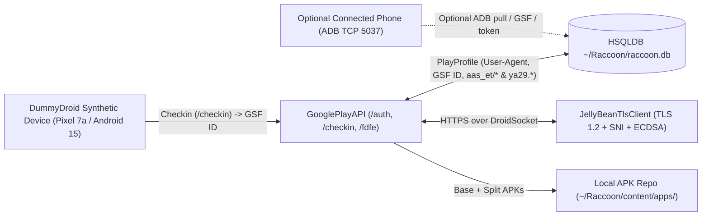

# Raccoon 4 Modernization & Architecture Guide

This document details all changes made in the [`eric-sabe/raccoon4`](https://github.com/eric-sabe/raccoon4) fork to modernize the original 2015–2020 codebase for **Java 21**, **Gradle 9.7**, **modern Google Play TLS/OAuth2/FDFE protocols**, **Android 14/15 (SDK 34–35) split APKs & ADB protocols**, and **phone-free DummyDroid synthetic device checkin**.

---

## Commit Summary

| Commit | Scope | Summary | Files |
| :--- | :--- | :--- | :---: |
| [`2f36b0e`](https://github.com/eric-sabe/raccoon4/commit/2f36b0e) | `build` | Upgrade to Gradle 9.7.1, Java 21 compatibility, and modern dependencies | 9 |
| [`c15fa43`](https://github.com/eric-sabe/raccoon4/commit/c15fa43) | `fix(net)` | Upgrade custom BouncyCastle TLS stack from TLS 1.0 to TLS 1.2 + SNI + ECDSA | 5 |
| [`9496920`](https://github.com/eric-sabe/raccoon4/commit/9496920) | `fix(ptools,repo)` | Fix ADB protocol framing, Android 10–15 shell commands, and SDK 30+ APK parsing | 11 |
| [`cf1dbe5`](https://github.com/eric-sabe/raccoon4/commit/cf1dbe5) | `feat(gplay)` | Support OAuth2 Bearer (`ya29.*`), master tokens (`aas_et/*`), and Android 14/15 device profiles | 11 |
| [`743a634`](https://github.com/eric-sabe/raccoon4/commit/743a634) | `feat(cli,importer)` | Add CLI (`--gp-setup`, `--adb-devices`, `--adb-list`, `--adb-pull`) and GUI phone APK importer | 6 |
| [`172851e`](https://github.com/eric-sabe/raccoon4/commit/172851e) | `feat(dummydroid)` | Integrate DummyDroid synthetic device profiles & standalone GSF ID checkin | 12 |
| [`ec194c9`](https://github.com/eric-sabe/raccoon4/commit/ec194c9) | `fix(gplay)` | Auto-refresh Play OAuth2 tokens on HTTP 401 / `DF-DFERH-01` and explain 1-hour phone token TTL | 3 |

---

## Architecture & Data-Flow Overview

---

## 1. Build System & Java 21 Compatibility (`2f36b0e`)

The original build relied on Gradle 2.x/4.x conventions (`compile`, `testCompile`), unmaintained third-party Gradle plugins (`launch4j`, `gradle-macappbundle`), and Java 8 APIs removed or deprecated in Java 21.

### File-by-File Changes
* **[`gradle/wrapper/gradle-wrapper.properties`](../gradle/wrapper/gradle-wrapper.properties)**: Pointed wrapper distribution to `gradle-9.7.1-bin.zip`.
* **[`build.gradle`](../build.gradle)**:
  * Replaced legacy `compile`/`testCompile` configurations with `implementation`/`testImplementation`.
  * Replaced dead third-party bundler plugins with standard `java`, `application`, and a self-contained `fatJar` task (`build/libs/Raccoon-desktop-4.25.0.jar`).
  * Upgraded libraries: `org.bouncycastle:bctls-jdk18on:1.78.1`, `com.google.protobuf:protobuf-java:3.25.5`, `org.apache.httpcomponents:httpclient:4.5.14`, `org.apache.httpcomponents:httpcore:4.4.16`, `org.hsqldb:hsqldb:2.7.4`, `commons-cli:commons-cli:1.9.0`, `commons-io:commons-io:2.17.0`, `commons-codec:commons-codec:1.17.1`, `com.google.zxing:core:3.5.3`, and `net.dongliu:apk-parser:2.6.10`.
* **[`gradle.properties`](../gradle.properties)**: Bumped version from `4.25.0-SNAPSHOT` to `4.25.0`.
* **[`Version.java`](../src/main/java/de/onyxbits/weave/util/Version.java)**: Stripped `-SNAPSHOT` or pre-release suffixes before integer parsing so `new Version(...)` never crashes on pre-release strings.
* **[`Bookmarks.java`](../src/main/java/de/onyxbits/raccoon/Bookmarks.java)**: Updated URLs to `https://` and removed a runtime `IllegalArgumentException` check that crashed startup if `BASE` was not `http://`.
* **[`MockUtil.java`](../src/main/java/de/onyxbits/raccoon/util/MockUtil.java)**: Replaced removed `Class.newInstance()` with `getDeclaredConstructor().newInstance()`.
* **[`LifecycleManager.java`](../src/main/java/de/onyxbits/weave/LifecycleManager.java)**: Removed calls to `Window.setAppletContext(...)` which broke under Java 21.

---

## 2. Custom TLS 1.2 Stack with SNI & ECDSA (`c15fa43`)

Raccoon uses a custom BouncyCastle TLS socket (`DroidSocket`) to mimic an Android device's TLS fingerprint when talking to `android.clients.google.com`. The original code used BouncyCastle 1.52's `DefaultTlsClient` hardcoded to **TLS 1.0** without SNI or ECDSA signature algorithms, causing immediate TLS `handshake_failure(40)` / `internal_error(80)` rejections from Google's servers.

### File-by-File Changes
* **[`JellyBeanTlsClient.java`](../src/main/java/de/onyxbits/raccoon/net/JellyBeanTlsClient.java)** & **[`LegacyTlsClient.java`](../src/main/java/de/onyxbits/raccoon/net/LegacyTlsClient.java)**:
  * Migrated to `org.bouncycastle.tls.*` (`bctls-jdk18on:1.78.1`) with `BcTlsCrypto(new SecureRandom())`.
  * Negotiates **TLS 1.2** (`ProtocolVersion.TLSv12`) with modern ECDHE + ECDSA/RSA AES-GCM cipher suites (`TLS_ECDHE_ECDSA_WITH_AES_128_GCM_SHA256`, `TLS_ECDHE_RSA_WITH_AES_128_GCM_SHA256`, etc.).
  * Added **Server Name Indication (SNI)** (`ServerName` extension) in `getClientExtensions()` when connecting by hostname so Google's frontends route the TLS handshake properly.
* **[`DroidSocket.java`](../src/main/java/de/onyxbits/raccoon/net/DroidSocket.java)** & **[`DroidSocketFactory.java`](../src/main/java/de/onyxbits/raccoon/net/DroidSocketFactory.java)**:
  * Passed the remote `host` string into `JellyBeanTlsClient` so SNI is populated on both direct and layered sockets.
  * Updated `TlsClientProtocol.connect(...)` to the modern BouncyCastle 1.78 API.
* **[`TlsTest.java`](../src/test/java/de/onyxbits/raccoon/net/TlsTest.java)**: Updated TLS handshake test for the modernized socket factory.

---

## 3. ADB Protocol Framing, Android 15 Shell Commands & SDK 30+ APK Parsing (`9496920`)

Three separate device/APK subsystems failed on modern Android (Android 10–15):
1. **ADB Socket Framing (`Invalid length` IOException)**: Raccoon's `BridgeManager.exec()` read an `OKAY` status and then tried to parse the next 4 bytes of raw shell stream output as a hex length header—which only exists on `host:` queries, not `shell:` streams.
2. **Android 10–15 Shell Changes**:
   * `sqlite3` is no longer shipped on production Android builds (`sqlite3: inaccessible or not found`), breaking `getGsfId()` and `getAccount()`.
   * `pm path <pkg>` now returns multiple `package:` lines (one for `base.apk` plus each `split_config.*.apk`), which broke `install()` and `pull()`.
   * `SyncService.pull()` did not strip trailing `\r\n` from paths, causing `FAIL: remote No such file or directory`.
3. **Android 11+ (SDK 30+) APK Parsing**: `apk-parser` 2.1.5 crashed on uncompressed `resources.arsc` / Android 11–15 manifest attributes (`ApkNode.extractFrom()`).

### File-by-File Changes
* **[`BridgeManager.java`](../src/main/java/de/onyxbits/raccoon/ptools/BridgeManager.java)**: Fixed `exec()` only to read a 4-byte hex length frame on `host:` commands, leaving `shell:` and `sync:` streams uncorrupted.
* **[`Device.java`](../src/main/java/de/onyxbits/raccoon/ptools/Device.java)**:
  * Added [`getGsfId()`](../src/main/java/de/onyxbits/raccoon/ptools/Device.java#L211-L263) fallbacks: queries `content query --uri content://com.google.android.gsf.gservices --where "name='android_id'"` (non-root) and falls back to `su -c "strings /data/data/com.google.android.gsf/databases/gservices.db ..."`.
  * Added [`getAccount()`](../src/main/java/de/onyxbits/raccoon/ptools/Device.java#L270-L320) fallbacks: parses `dumpsys account` (non-root) and `/data/system_ce/0/accounts_ce.db` via `su`.
  * Added [`getGooglePlayToken()`](../src/main/java/de/onyxbits/raccoon/ptools/Device.java#L326-L379) to extract active Google Play `ya29.*` OAuth2 tokens (or `aas_et/*` master tokens) from `/data/system_ce/0/accounts_ce.db` when rooted.
  * Added [`listInstalledPackages()`](../src/main/java/de/onyxbits/raccoon/ptools/Device.java#L386-L416) and [`getPackageApkPaths(String)`](../src/main/java/de/onyxbits/raccoon/ptools/Device.java#L424-L445) to enumerate third-party packages and all split APK paths.
* **[`SyncService.java`](../src/main/java/de/onyxbits/raccoon/ptools/SyncService.java)**: Trimmed trailing whitespace/newlines from remote paths before sending `STAT`/`RECV` packets.
* **[`ApkNode.java`](../src/main/java/de/onyxbits/raccoon/repo/ApkNode.java)**: Upgraded to `net.dongliu:apk-parser:2.6.10` and guarded icon extraction against adaptive XML drawables (`<adaptive-icon>`) and `Exception`s so split/modern APKs import cleanly.
* **[`AndroidAppDao.java`](../src/main/java/de/onyxbits/raccoon/repo/AndroidAppDao.java)**: Replaced `FilenameFilter` lambda that choked on non-APK files in app directories and parsed split APK filenames (`config.<split>-<versionCode>.apk`).

---

## 4. Google Play API: OAuth2 Bearer Tokens (`ya29.*`), Master Tokens (`aas_et/*`), and Android 14/15 Profiles (`cf1dbe5`)

Google Play's FDFE endpoint (`https://android.clients.google.com/fdfe/...`) deprecated legacy `GoogleLogin auth=...` tokens in favor of OAuth2 Bearer tokens (`Authorization: Bearer ya29...`) and rejects old Android 4.x User-Agents (`Android-Finsky/4.x ... sdk=16`) for modern apps targeting SDK 34/35.

### File-by-File Changes
* **[`GooglePlayAPI.java`](../src/main/java/com/akdeniz/googleplaycrawler/GooglePlayAPI.java)**:
  * Updated default `Finsky` User-Agent to an Android 15 / SDK 35 Pixel 7a profile (`Android-Finsky/41.2.29-31 ... versionCode=84122930,sdk=35,device=lynx,hardware=lynx,product=lynx...`).
  * Updated [`getHeaderParameters()`](../src/main/java/com/akdeniz/googleplaycrawler/GooglePlayAPI.java#L439-L458) to send `Authorization: Bearer <token>` whenever the token begins with `ya29.`, while remaining backward-compatible with `GoogleLogin auth=<token>`.
  * Updated [`checkin()`](../src/main/java/com/akdeniz/googleplaycrawler/GooglePlayAPI.java#L477-L523) to support `aas_et/` and `ya29.` tokens cleanly.
* **[`Identity.java`](../src/main/java/com/akdeniz/googleplaycrawler/Identity.java)**:
  * Added support in [`signIn()`](../src/main/java/com/akdeniz/googleplaycrawler/Identity.java#L172-L263) for:
    1. Direct `ya29.*` OAuth2 access tokens (bypasses `/auth` and uses the Bearer token directly).
    2. `aas_et/*` master tokens (exchanges the master token via `Token` parameter at `https://android.clients.google.com/auth` for a fresh `ya29.*` token).
    3. `oauth2_4/*` tokens (exchanges at `/auth` with `ACCESS_TOKEN=1` to obtain a permanent `aas_et/*` master token + `ya29.*` Play token).
    4. 16-character Google App Passwords (authenticates via `EncryptedPasswd` and saves the returned `aas_et/*` master token so Raccoon stays authenticated).
* **[`DefaultDevice.java`](../src/main/java/com/akdeniz/googleplaycrawler/misc/DefaultDevice.java)**: Updated synthetic checkin device configuration to match a modern Android 14/15 arm64-v8a device (`sdkVersion=34`, `arm64-v8a`, OpenGL ES 3.2, modern system shared libraries and features).
* **[`LoginLogic.java`](../src/main/java/de/onyxbits/raccoon/setup/LoginLogic.java)** & **[`PlayManager.java`](../src/main/java/de/onyxbits/raccoon/gplay/PlayManager.java)**:
  * Persisted the upgraded `aas_et/*` master token into `PlayProfile.password` on sign-in.
  * When `PlayManager.login()` is triggered on token expiry, automatically checks if an authorized phone is attached over ADB to refresh `ya29.*` seamlessly before falling back to `/auth`.

---

## 5. CLI Automation (`--gp-setup`, `--adb-*`) & GUI Connected-Phone APK Importer (`743a634`)

Added full command-line support for profile setup, automatic latest-version Play downloads, and ADB device inspection/pulling, plus updated the GUI's `ImportAppAction` so **Market -> Import from device** can pull apps directly off a connected Android phone.

### File-by-File Changes
* **[`Router.java`](../src/main/java/de/onyxbits/raccoon/cli/Router.java)**: Registered CLI flags:
  * `--gp-setup [user,password_or_token]`
  * `--adb-devices`
  * `--adb-list`
  * `--adb-pull <packageId>`
* **[`Play.java`](../src/main/java/de/onyxbits/raccoon/cli/Play.java)**:
  * Allowed `--gpa-download <packageId>` without requiring a manual `,versionCode,offerType` suffix (automatically queries `api.details(doc)` for the latest `versionCode` and `offerType`).
  * Implemented `setupProfile()`, `adbDevices()`, `adbList()`, and `adbPull()` (which pulls `base.apk` plus all `split_config.*.apk` files into `~/Raccoon/content/apps/<pkg>/` and registers them in HSQLDB).
* **[`ImportAppAction.java`](../src/main/java/de/onyxbits/raccoon/importer/ImportAppAction.java)** & **[`ImportFromDeviceWorker.java`](../src/main/java/de/onyxbits/raccoon/importer/ImportFromDeviceWorker.java)**:
  * Updated GUI **Market -> Import Apps** to let the user choose between importing local `.apk` files from disk or selecting installed apps directly from a connected ADB phone.

---

## 6. DummyDroid Integration for Phone-Free Operation (`172851e`)

Integrated DummyDroid's device-profile and GSF ID checkin engine directly into Raccoon (`SyntheticDevice`), removing any dependency on either a physical Android phone or the archived upstream `onyxbits/dummydroid` binary.

### File-by-File Changes
* **[`SyntheticDevice.java`](../src/main/java/de/onyxbits/raccoon/gplay/SyntheticDevice.java)**:
  * Parses DummyDroid `.properties` and Android `build.prop` files into `AndroidCheckinProto` / `DeviceConfigurationProto` protobufs and corresponding `Android-Finsky/...` User-Agent strings.
  * Ships with a built-in **Google Pixel 7a (`lynx`, Android 15 / SDK 35)** preset (`loadBundledDefault()`).
  * Can snapshot a live connected phone over ADB into a reusable DummyDroid `.properties` file (`fromConnectedDevice(Device)`).
  * Generates realistic randomized hardware identifiers (`generateRandomMac()`, `generateRandomSerial()`, `generateRandomMeid()`) for each checkin.
* **[`DefaultDevice.java`](../src/main/java/com/akdeniz/googleplaycrawler/misc/DefaultDevice.java)**: Delegated default checkin protobuf generation to `SyntheticDevice.loadBundledDefault()`.
* **[`pixel7a_android15.properties`](../src/main/resources/de/onyxbits/raccoon/gplay/pixel7a_android15.properties)**: Bundled default DummyDroid profile (Pixel 7a, Android 15 AP3A.241005.015, SDK 35, `arm64-v8a`, Finsky `41.2.29-31`, GMS `244738035`, full shared libraries, locales, OpenGL ES 3.2 extensions, and system features).
* **[`Router.java`](../src/main/java/de/onyxbits/raccoon/cli/Router.java)** & **[`Play.java`](../src/main/java/de/onyxbits/raccoon/cli/Play.java)**:
  * Added `--dummydroid [file.properties]` to register a fresh synthetic GSF ID with Google Play and bind it to the active Raccoon profile without a phone.
  * Added `--dummydroid-dump [out.properties]` to export a DummyDroid `.properties` profile (either from a connected phone or from the built-in Pixel 7a preset).
  * Updated `--gp-setup "email,password_or_token"` so that when no phone is connected via ADB, it automatically uses `SyntheticDevice` to register a new GSF ID.
* **[`MockLogic.java`](../src/main/java/de/onyxbits/raccoon/setup/MockLogic.java)**: Updated the GUI setup wizard's mock-device step to use `SyntheticDevice` User-Agent and checkin protobufs.
* **[`SyntheticDeviceTest.java`](../src/test/java/de/onyxbits/raccoon/gplay/SyntheticDeviceTest.java)**: Added unit tests verifying the bundled DummyDroid preset, protobuf generation, and round-trip `.properties` conversion.

---

## 7. Auto-Refresh OAuth2 Tokens on `HTTP 401` / `DF-DFERH-01` (`ec194c9`)

* **[`Identity.java`](../src/main/java/com/akdeniz/googleplaycrawler/Identity.java)**: Updated `SERVICE` to `oauth2:https://www.googleapis.com/auth/googleplay` so `Identity.signIn()` requests modern `ya29.*` OAuth2 Bearer tokens from Google's `/auth` endpoint whenever authenticating with a long-lived App Password or non-hardware-bound `aas_et/*` master token.
* **[`Play.java`](../src/main/java/de/onyxbits/raccoon/cli/Play.java)** & **[`SearchAppWorker.java`](../src/main/java/de/onyxbits/raccoon/gplay/SearchAppWorker.java)**: Detected `HTTP 401` / `DF-DFERH-01` (which Google Play FDFE returns inside a protobuf `ResponseWrapper` when a 1-hour `ya29.*` token expires), automatically refreshed the token using stored long-lived credentials (or a connected phone if present), and added an explicit diagnostic message when a phone-imported `ya29.*` token expires while the phone is unplugged.
